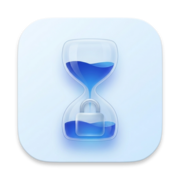
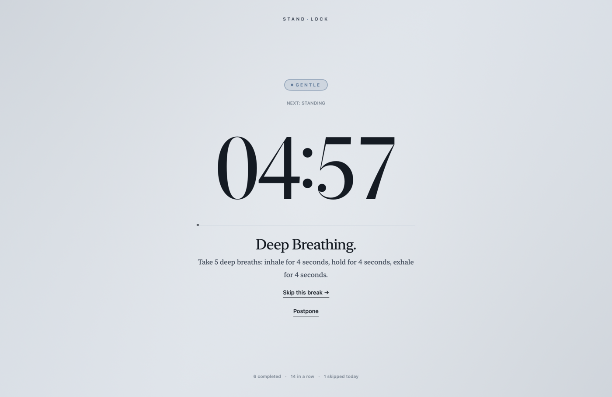
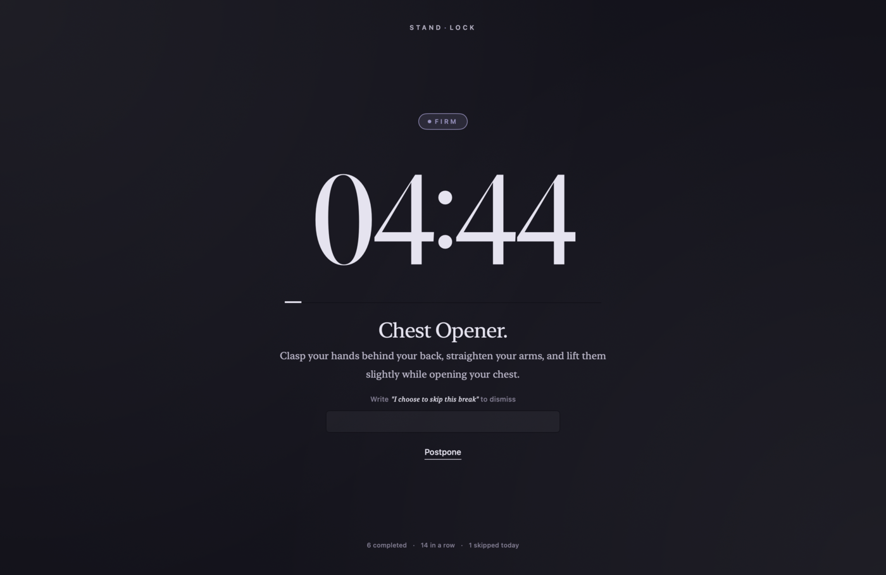
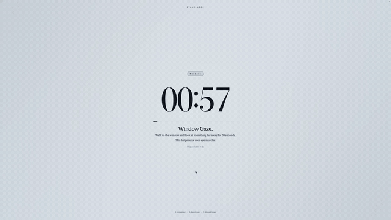
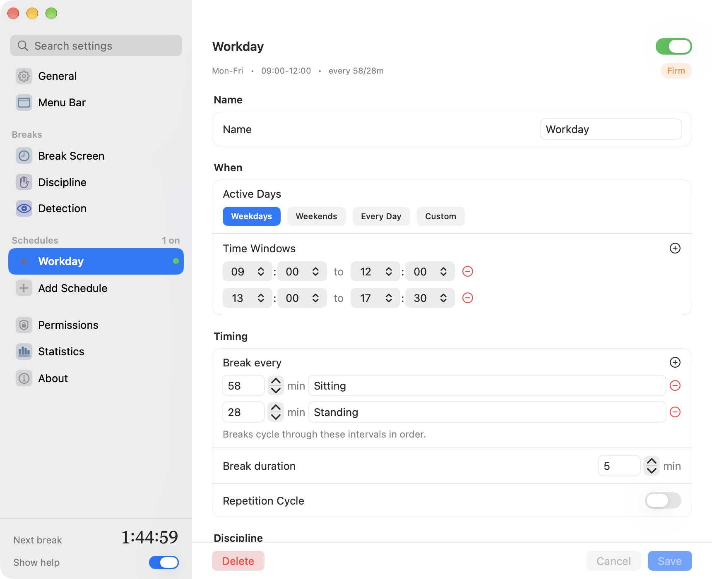
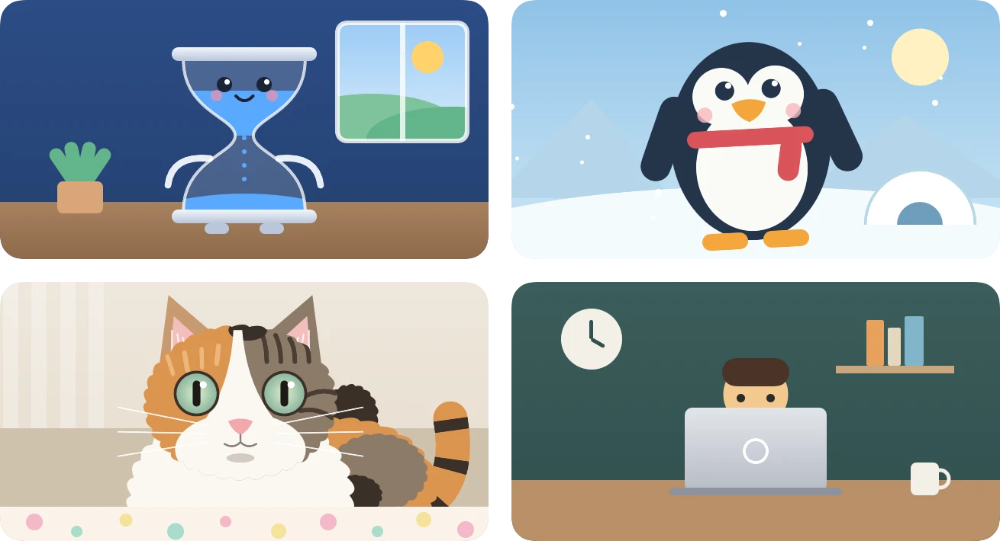
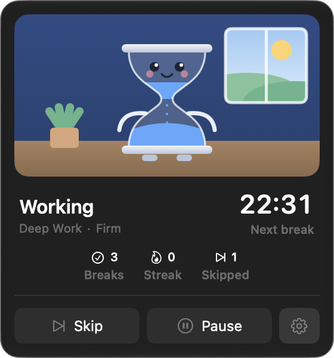
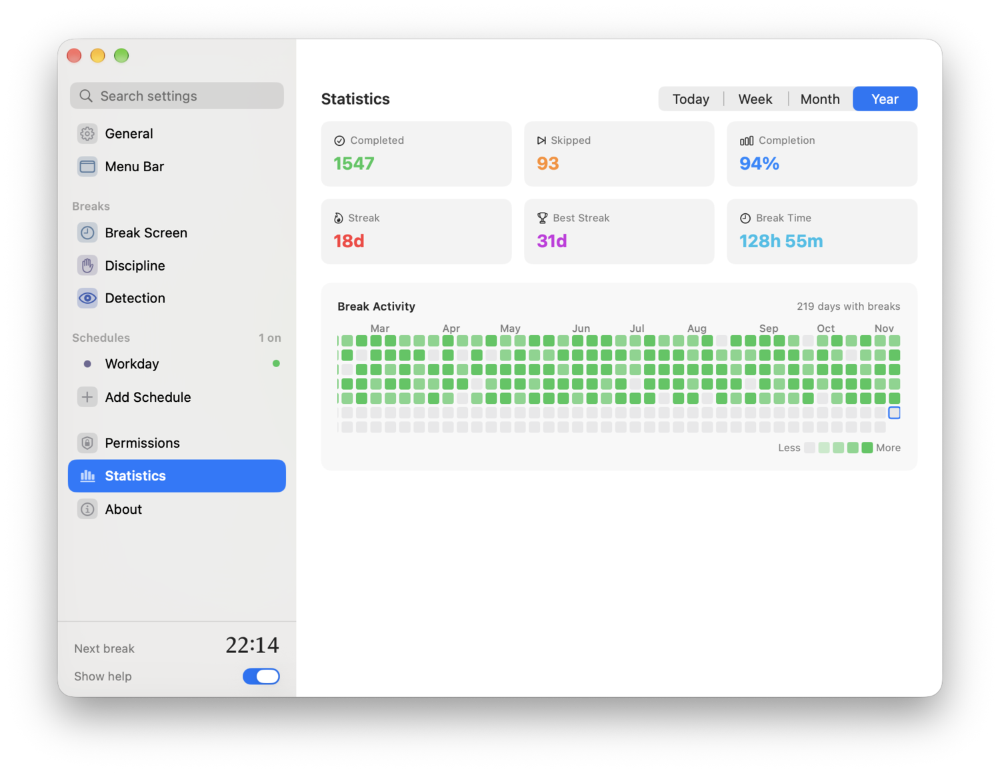
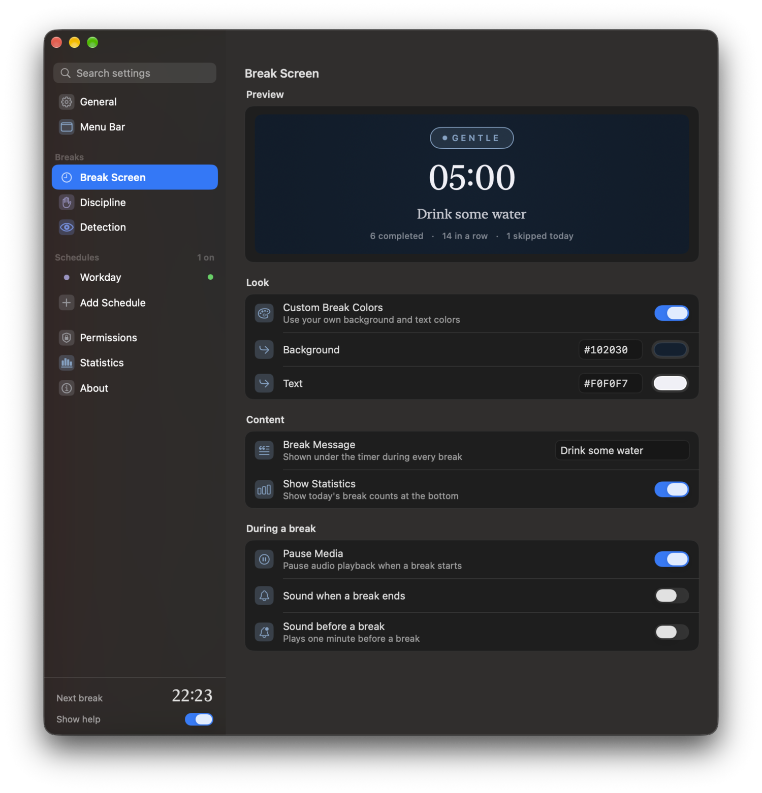

<div align="center">



# StandLock

**A macOS menu bar app that locks your screen until you stand up.**

[](https://github.com/yagizdo/StandLock/releases)
[](https://github.com/yagizdo/StandLock/releases)
[](https://github.com/yagizdo/standlock/actions/workflows/release.yml)
[](https://github.com/yagizdo/StandLock/releases/latest)
[](https://github.com/yagizdo/homebrew-tap)
[](LICENSE)
[](https://standlock.app?ref=github-readme)
[](https://buymeacoffee.com/yagizdo)



</div>

You know you should stand up. You've also dismissed every reminder that told you so.

StandLock doesn't ask. When a break is due, it covers every display with a countdown and an exercise, and you choose beforehand how hard it is to get out of. It's free and open source, written in Swift. There's no account to make and no analytics.

```bash
brew install --cask yagizdo/tap/standlock
```

Or [download the DMG](https://github.com/yagizdo/StandLock/releases/latest) and drag StandLock to Applications. Requires macOS 13 or later. Start on Gentle, where one click gets you out, and get stricter when you're ready.

## Features

### Hard to ignore

| Level | How you get out |
|-------|-----------------|
| Gentle | Click skip |
| Firm | Wait, then type a phrase |
| Strict | Input is blocked. Hold Ctrl+Option+Command to exit |

- Set a level per schedule and change it anytime
- Turn on escalation and each skip makes the next break harder: a button that runs from your cursor, mini-games, sentences you'd rather not type
- Complete a break and escalation resets
- Daily skip limits for Gentle and Firm

<p align="center">
  
  
</p>

### Fits your day

- Several schedules, each with its own days, hours and level
- Templates for 20-20-20, Pomodoro and 52/17
- Alternating intervals, like 58 minutes sitting and 28 standing
- Every break of the day listed before you save
- Breaks wait for meetings, screen recordings, screen sharing and calendar events
- If you were already away from your desk, the break counts as done
- You can postpone a break once when a call comes up

<p align="center"></p>

### A scene in your menu bar

- Pick one of 19 scenes, from an hourglass or a calico cat to a capybara in a hot spring, or turn it off
- The scene changes with your break: alert in the last minute, resting when you pause
- Countdown, today's stats, Skip and Pause in one panel

<p align="center"></p>

<p align="center"></p>

### Streaks, colours and the rest

- Completions, skips, streaks and a year heatmap
- Your own break screen colours and message
- Pauses your media during a break, with optional sounds before and after
- System, Light or Dark, in English, Turkish or Simplified Chinese
- Launch at login, and updates through Sparkle (automatic checks off by default) or Homebrew (daily check, one click)
- Export your settings and schedules to a file and import them on another Mac

<p align="center">
  
  
</p>

<div align="center">

**[Download StandLock](https://github.com/yagizdo/StandLock/releases/latest)**

</div>

## Permissions

StandLock asks only when you use a feature that needs a permission. If you revoke one, Strict schedules run as Firm and calendar integration is skipped until you grant it again.

| Permission | Used for |
|------------|----------|
| Accessibility | Strict mode: blocks keyboard and mouse during breaks |
| Input Monitoring | Strict mode: the emergency key combo |
| Calendar | Optional: reads events to defer breaks, never changes them |

StandLock does not open your camera or microphone. It only checks whether another app is using them.

## Build from source

```bash
git clone https://github.com/yagizdo/StandLock.git
cd StandLock
open StandLock.xcodeproj
```

Build and run the `StandLock` scheme.

## Contributing

Bug fix: open a PR. Feature or behaviour change: open an issue first. Setup, tests and PR expectations are in [CONTRIBUTING.md](CONTRIBUTING.md).

## License

MIT · Yilmaz Yagiz Dokumaci ([yagizdo](https://x.com/yagizdo))
